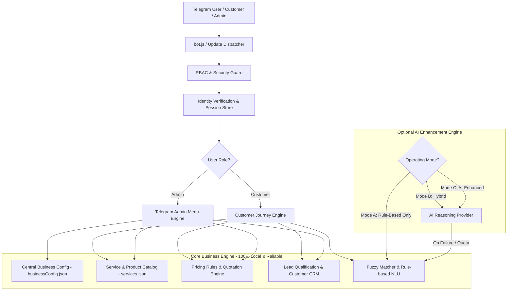
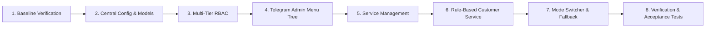

# Ariiti Tech Telegram-First Intelligent Business Bot
## Repository Assessment & First Milestone Implementation Plan

> **Date:** November 2026  
> **Status:** Proposal & Assessment Awaiting Owner Approval  
> **Target System:** `bot/` (Telegram-first Node.js architecture)

---

## 1. Executive Summary

This document presents a comprehensive assessment of the existing Telegram bot repository and delivers a detailed, phased implementation plan for transforming it into **Ariiti Tech's Telegram-first Intelligent Business Bot**. 

In accordance with the project specification:
1. **Rule-Based Foundation:** The bot will operate on an independent, resilient rule-based business engine.
2. **Zero Hard Dependency on AI:** AI is an optional enhancement; when disabled, offline, or failing, 100% of business operations (service browsing, inquiry intake, quotes, admin controls) function without degradation.
3. **Telegram-First Administration:** The primary interface for Admins is Telegram inline keyboards and guided conversational state machines—no external web dashboard required.
4. **Two-Role Architecture:** Simplified, clean access model with exactly two roles: **Admin** and **Customer** (no complex owner/employee sub-tiering).
5. **Phased Milestone Delivery:** We strictly focus on **First Development Milestone** requirements before embarking on advanced AI features.

---

## 2. Existing Repository Assessment

### 2.1 File & Module Inventory

```
bot/
├── bot.js                          # Application entry point, polling/webhook, HTTP health check (port 3010)
├── package.json                    # Dependencies & scripts
├── replies.json                    # Canned & conversational replies with multilingual translations
├── .env                            # Active credentials (TELEGRAM_BOT_TOKEN, ADMIN_CHAT_ID, PORT)
├── data/                           # Flat JSON persistence layer
│   ├── users.json                  # User identity directory
│   ├── stats.json                  # User stats & language preferences
│   ├── memories.json               # Session states, rolling message memory & user context
│   ├── actionLog.json              # System and security audit logs
│   └── blocked.json               # Blacklisted user accounts
├── logs/                           # Winston rotating log files
└── src/
    ├── handlers/
    │   ├── messageHandler.js       # Main message router, active state dispatcher, NLU parser
    │   ├── commandHandler.js       # Public slash commands (/start, /help, /weather, etc.)
    │   ├── adminCommandHandler.js  # Admin commands (/admin, /logs, /users, /block, etc.)
    │   └── callbackHandler.js      # Inline keyboard callback dispatcher
    ├── services/
    │   ├── nluService.js           # Local BayesClassifier + Jaro-Winkler fuzzy token scoring
    │   ├── memoryService.js        # Multi-turn state store (STATE_QUOTE_*), session attributes
    │   ├── userService.js          # User registration & activity metrics
    │   ├── replyService.js         # Dynamic variation picker with anti-repetition memory
    │   ├── adminNotifier.js        # Direct Telegram alerts to ADMIN_CHAT_ID
    │   ├── i18nService.js          # Multi-language dictionary loader (English + Afaan Oromoo)
    │   ├── weatherService.js       # OpenWeatherMap integration
    │   ├── reminderService.js      # In-memory timed reminder scheduler
    │   ├── blockService.js         # User restriction store
    │   ├── eventTracker.js         # System performance & error tracker
    │   └── actionLogService.js     # User action audit logging
    └── utils/
        ├── dataStore.js            # Safe JSON file load/save abstraction
        ├── logger.js               # Winston logger configuration
        ├── helpers.js              # Formatting & helper utilities
        └── constants.js            # Ports, state enums, intent constants
```

### 2.2 Technology Stack
- **Runtime:** Node.js (v22.x LTS compatible, CommonJS)
- **Telegram Bot Framework:** `node-telegram-bot-api` (^0.64.0) with polling & webhook support
- **Natural Language Processing:** `natural` (^6.10.4) for tokenization, Bayes classification, and Jaro-Winkler fuzzy distance matching; `sentiment` (^5.0.2) for emotional score detection
- **Logging & Monitoring:** `winston` (^3.11.0) with `winston-daily-rotate-file` (^4.7.1)
- **Persistence:** Local JSON file storage via atomic helper `src/utils/dataStore.js`
- **External Dependencies:** Zero required cloud APIs for core operations

### 2.3 Current Working Capabilities
1. **Multilingual Local NLU:** 12 trained intents with typo tolerance (English, Afaan Oromoo, Amharic keywords) without cloud AI API.
2. **Context Memory & Session State:** Multi-turn session management (`STATE_QUOTE_SERVICE` $\to$ `STATE_QUOTE_DESC` $\to$ `STATE_QUOTE_BUDGET` $\to$ `STATE_QUOTE_CONTACT`).
3. **Interactive Guided Wizard:** 4-step quotation intake flow with admin notification on completion.
4. **Dynamic Anti-Repetitive Responses:** Variation picker that avoids robotic repetitions.
5. **Administrative Controls:** `/admin` dashboard displaying system metrics, user lists, user blocking, action logs, and system info.

---

## 3. Gap Analysis vs. Ariiti Tech Specification

| Feature Area | Current State | Target Ariiti Tech Business Bot Requirement |
| :--- | :--- | :--- |
| **User Roles & RBAC** | Single binary check (`ADMIN_CHAT_ID`) | Two dedicated roles: **Admin** (full management) and **Customer** (service discovery, quotes, inquiries) |
| **Service Catalog** | Hardcoded text in `replies.json` & `nluService.js` | Persistent, dynamic `services.json` editable directly via Telegram Admin menu |
| **Pricing & Packages** | Approximate budget collection | Structured catalog with base price, package tiers, hourly rates, and dynamic quotation builder |
| **Lead & Customer CRM** | User message counter (`users.json`, `stats.json`) | Customer profiles, lead qualification stages (`New`, `Contacted`, `Qualified`, `Proposal`, `Won`, `Lost`), assigned employees |
| **Telegram Admin UX** | Text command responses (`/block`, `/logs`) | Full nested interactive inline keyboard menus with confirmation modals for sensitive actions |
| **Business Configuration**| Static constants in code | Dynamic `businessConfig.json` (company profile, operating hours, operating mode, contact channels, lead rules) |
| **AI Operating Modes** | Rule-based only (external AI code removed) | Tri-mode engine: **A (Rule-based only)**, **B (Hybrid with automatic fallback)**, **C (AI-enhanced)** |
| **Approval Workflow** | None | Pending approval queue for quotes, profile updates, and critical customer escalations |

---

## 4. Target Architecture



---

## 5. Domain Data Models (Milestone 1)

All records will be maintained in structured JSON data files inside `bot/data/` using atomic read/write and file-locking patterns.

### 5.1 Business Configuration (`data/businessConfig.json`)
```json
{
  "company": {
    "name": "Ariiti Tech",
    "legalName": "Ariiti Technologies PLC",
    "tagline": "Intelligent Digital Solutions, E-Commerce & Systems",
    "email": "contact@ariititech.com",
    "phone": "+251911000000",
    "telegram": "@AriitiTech",
    "website": "https://ariiti.com",
    "location": "Addis Ababa, Ethiopia",
    "operatingHours": "Mon-Fri 8:30 AM - 5:30 PM EAT"
  },
  "operatingMode": "rule_based", // "rule_based" | "hybrid" | "ai_enhanced"
  "aiConfig": {
    "provider": "gemini",
    "model": "gemini-1.5-flash",
    "enabled": false,
    "temperature": 0.3,
    "timeoutMs": 8000
  },
  "leadScoring": {
    "hasBudget": 30,
    "hasTimeline": 20,
    "verifiedContact": 25,
    "detailedDescription": 25
  },
  "notificationPreferences": {
    "notifyAdminOnNewLead": true,
    "notifyAdminOnQuote": true
  }
}
```

### 5.2 Service & Product Catalog (`data/services.json`)
```json
[
  {
    "id": "srv_web_dev",
    "name": "Full-Stack Web Development",
    "category": "Engineering",
    "description": "High-performance React, Tailwind CSS, Node.js and Django web applications.",
    "features": [
      "Responsive UI/UX",
      "Secure REST APIs",
      "Database Integration (PostgreSQL/MySQL)",
      "Role-Based Access Control",
      "Deployment & CI/CD"
    ],
    "pricingModel": "milestone", // "fixed" | "milestone" | "hourly" | "custom"
    "startingPrice": 800,
    "currency": "USD",
    "estimatedDays": 14,
    "isActive": true,
    "isFeatured": true
  },
  {
    "id": "srv_telegram_bot",
    "name": "Custom Telegram Business Bots",
    "category": "Automation",
    "description": "Intelligent conversational bots for customer service, order intake, and workflows.",
    "features": [
      "Custom Inline Keyboards",
      "Multi-language (EN/OM/AM)",
      "Database & Payment Integration",
      "Admin Control Panel via Telegram",
      "Automated Alerts"
    ],
    "pricingModel": "fixed",
    "startingPrice": 450,
    "currency": "USD",
    "estimatedDays": 7,
    "isActive": true,
    "isFeatured": true
  }
]
```

### 5.3 User Roles & Permissions (`data/roles.json`)
```json
{
  "adminIds": [7458921957],
  "permissions": {
    "admin": [
      "manage_services",
      "view_reports",
      "view_leads",
      "edit_pricing",
      "config_ai",
      "manage_admins",
      "view_audit_logs"
    ],
    "customer": [
      "view_services",
      "request_quote",
      "submit_inquiry"
    ]
  }
}
```

### 5.4 Lead & Quotation Records (`data/leads.json` & `data/quotes.json`)
- **Lead Record:** ID, customerId, customerName, serviceId, description, budget, timeline, contact, score, stage (`new` | `contacted` | `qualified` | `proposal` | `won` | `lost`), createdAt, updatedAt.
- **Quote Record:** ID, leadId, customerId, serviceId, lineItems, calculatedSubtotal, discount, finalPrice, status (`draft` | `approved` | `sent` | `accepted`), generatedBy.

---

## 6. Implementation Plan: Milestone 1

Milestone 1 establishes the rock-solid business core without external AI dependencies, fulfilling Section 10 of the specification.



### Step 1: Central Business Configuration & Storage
- Create `data/businessConfig.json`, `data/services.json`, `data/roles.json`, `data/leads.json`, and `data/quotes.json`.
- Implement `src/services/businessConfigService.js` to manage configuration loading, schema validation, persistence, and instant in-memory reflection.
- Implement `src/services/serviceCatalogService.js` with CRUD operations for services (add, edit, toggle active status, remove).

### Step 2: Role-Based Access Control (RBAC - Admin & Customer)
- Implement `src/services/rbacService.js` supporting:
  - Role resolution: `isAdmin(userId)`, `isCustomer(userId)`.
  - Permission checks: `hasPermission(userId, permissionName)`.
  - Admin management: Add/remove secondary admins via Telegram inline keyboard (primary admin `7458921957` protected from removal).
- Protect all administrative commands (`/admin`, admin callbacks) through unified middleware guards. Non-admins cannot access admin menus or business data.

### Step 3: Telegram Business Admin Menu (Interactive Inline Tree)
- Implement `src/handlers/businessAdminHandler.js` with nested inline menus:
  - `admin_main`: Main dashboard with quick counts (Active Services, Leads, Operating Mode).
  - `admin_services`: List services, view service details, toggle active/inactive, change price.
  - `admin_config`: View and update business profile, contact channels, operating hours.
  - `admin_mode`: Toggle Operating Mode (Rule-based, Hybrid, AI-enhanced).
  - `admin_leads`: View pipeline status (`New`, `Qualified`, `Proposal`, `Won`).
  - `admin_admins`: View and manage administrator IDs.
  - `admin_audit`: View recent admin action logs.
- Include confirmation steps for destructive actions (e.g. deleting or disabling a core service).

### Step 4: Rule-Based Customer Journey & Automated Quotation
- Upgrade `src/handlers/messageHandler.js` to draw directly from `services.json` rather than static code.
- Dynamic Service Discovery: Customers can browse active categories and services with inline cards.
- Enhanced Quotation Engine:
  - Links selected service directly to the 4-step wizard.
  - Calculates preliminary quote estimates based on configured service pricing and selected package tier.
  - Automatically records the submission in `data/leads.json` and `data/quotes.json`.
  - Sends high-priority lead notification to Admin on Telegram.

### Step 5: Tri-Mode Engine & Robust Fallback Architecture
- Implement `src/services/aiModeService.js`:
  - Mode A: Rule-Based Only (bypass external API calls entirely).
  - Mode B: Hybrid (attempt AI assistance for natural phrasing; automatically fall back to rule-based parser on any failure, timeout, or rate-limit).
  - Mode C: AI-Enhanced.
- In all modes, customer inquiry intake, service catalog lookups, and quote submissions execute through rule-based validators so no customer message is ever lost.

### Step 6: Audit Logging & Activity Monitoring
- Enhance `src/services/actionLogService.js` to record all role checks, admin configuration changes, service modifications, and quote submissions with timestamps and actor IDs.

---

## 7. Acceptance Test Matrix (Milestone 1)

| # | Acceptance Criterion | Test Method | Expected Result |
| :---: | :--- | :--- | :--- |
| **1** | Admin service management via Telegram | Admin accesses `/admin` $\to$ Services $\to$ Toggle status / edit price | Changes persist to `services.json` and appear immediately to customers |
| **2** | RBAC enforcement | Non-admin sends `/admin` or triggers admin callback | Access denied with security alert logged in `actionLog.json` |
| **3** | Customer catalog browsing without AI | Customer clicks `[🛠 Services]` or sends *"services"* with Mode A | Dynamic list of active services displayed with details and pricing |
| **4** | Customer inquiry submission without AI | Customer completes the 4-step quote wizard | Lead recorded in `leads.json`, quote generated in `quotes.json`, admin alerted |
| **5** | Rule-based recommendations | Customer enters requirements (e.g. *"I need a mobile app"*) | System recommends Full-Stack or Mobile service with quote button |
| **6** | Price calculation from catalog | Customer requests quote for specific service | Calculated estimate generated using base price and scope factor |
| **7** | Instant reflection of admin changes | Admin updates company phone or service price | Next customer inquiry immediately shows updated information |
| **8** | AI toggle without breakage | Admin toggles mode from Hybrid $\to$ Rule-based | Bot continues functioning 100% locally with zero downtime |
| **9** | AI error resilience | Simulated network drop or invalid AI API key | Hybrid mode falls back silently to local NLU; zero messages lost |
| **10**| Data segregation | Customer executes commands | Private business metrics and admin menus remain inaccessible |
| **11**| Audit logging | Admin performs modifications | Action logged with timestamp, user ID, and diff in `actionLog.json` |
| **12**| Legacy command compatibility | User sends `/language`, `/weather`, `/ping` | Existing utility features remain fully operational |

---

## 8. Next Steps & Owner Decision

To maintain project integrity and align with Section 9 ("Do not rewrite working features unnecessarily"), no existing files will be modified until you review and approve this assessment and implementation plan.

Please confirm if you approve this architectural roadmap so we can proceed with **Milestone 1 Implementation**.
